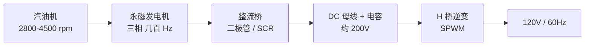

# AC-DC 整流入门（以变频发电机为例）

> 互动版（可调转速、负载、电容和触发角的波形图）：https://claude.ai/artifact/E8nYhYQTzx67NuWZme3Tyn

## 能量路径

本笔记只讲前半段：交流怎么变成直流。

## 1. 为什么发出来的是"高频"交流

转子有 $P$ 个磁极（$P/2$ 对），每转一圈每对磁极产生一个电周期。频率和电动势都与转速 $n$（rpm）成正比：

$$f = \frac{P}{2}\cdot\frac{n}{60}, \qquad E \approx k\, n$$

- 传统 3600 rpm 备用机：2 极 → 60 Hz。
- 变频机用多极，例如 20 极（10 对）在 3600 rpm → **600 Hz**。
- 频率高：铁芯和磁钢更小，滤波电容也更小。频率和电压随转速变，由后级整流和逆变"洗"掉。

## 2. 二极管：电流的单向阀

正向导通（压降约 0.7–1 V），反向截止。整流的思路：**让负载每时每刻接在"当前最高"和"当前最低"的两根线之间。**

| 电路 | 二极管数 | 纹波频率 | 不加电容时平均直流 |
|---|---|---|---|
| 单相半波 | 1 | $f$ | $0.45\,V_{rms}$ |
| 单相全波桥 | 4 | $2f$ | $0.90\,V_{rms}$ |
| **三相全桥（6 脉波）** | 6 | $6f$ | $1.35\,V_{LL,rms}$ |

三相全桥平均值推导：$V_{dc} = \frac{3\sqrt{2}}{\pi} V_{LL} \approx 1.35\,V_{LL}$。母线约 200 V 时，线电压有效值约 148 V。

## 3. 三相全桥：取上包络

- 上排 D1/D3/D5 阴极相连：哪相电压最高，哪个导通。
- 下排 D4/D6/D2 阳极相连：哪相电压最低，哪个导通。
- 输出 = $\max(|v_{ab}|, |v_{bc}|, |v_{ca}|)$，每个电周期换相 6 次。
- 不加电容时纹波峰峰值 = $V_m(1-\cos 30^\circ) \approx 13.4\%\,V_m$。

## 4. 电容滤波

电压接近峰值时二极管给电容充电，其余时间电容给负载放电。纹波估算：

$$\Delta V \approx \frac{I}{f_{ripple}\, C}$$

同样 10 A 负载、允许 5 V 纹波：

| 情况 | 纹波频率 | 需要的 C |
|---|---|---|
| 60 Hz 单相全波 | 120 Hz | ≈ 16,700 µF |
| 600 Hz 三相全桥 | 3,600 Hz | **≈ 560 µF** |

注意：
- 加电容后二极管只在峰值附近短时间导通，电流是窄而高的脉冲，谐波大。
- 逆变器输出单相 60 Hz 时，母线上还有 **120 Hz 功率脉动**，仍需母线电容承担（与储能 PCS 单相逆变相同）。

## 5. SCR（晶闸管）：可控整流

- 单向导电，门极触发才导通，电流过零才关断（自然换相）。
- 比自然换相点延迟 $\alpha$ 触发，平均电压下降：

$$\text{全控桥：} V_{dc} = 1.35\,V_{LL}\cos\alpha$$

$$\text{半控桥（3 SCR + 3 二极管）：} V_{dc} = 0.675\,V_{LL}(1+\cos\alpha)$$

变频发电机常用**半控桥**（便宜、无负电压），用途：
1. **稳母线**：转速高、电压富余时加大 $\alpha$，削掉多余电压。
2. **软充电**：开机时用大 $\alpha$ 慢慢给空电容充电，避免冲击电流，再逐渐减小 $\alpha$。

## 6. 母线电压为什么随负载变化

绕组有电感 $L_s$，换相不能瞬间完成（换相重叠），每次换相"吃掉"一块电压：

$$\Delta V \approx \frac{3}{\pi}\,\omega L_s\, I_{dc}$$

$\omega$ 正比于转速，所以**低转速 + 大负载**时母线最容易掉压。这就是 Eco 模式带电机负载容易出问题的原因。

| 稳母线的环节 | 响应速度 | 作用 |
|---|---|---|
| 母线电容 | µs–ms | 缓冲纹波和瞬间冲击 |
| SCR 触发角 | 一个电周期（约 1–2 ms） | 削掉多余电压 |
| 发动机调速（步进电机拉节气门） | 0.x–2 s | 负载大时提速 |
| 逆变器调制比 | 一个开关周期 | 母线波动时保持 120 V 输出 |

和储能的联系：在 DC 母线上通过双向 DC/DC 并一个电池，就能在毫秒级补上"发动机提速前"的功率缺口，这就是混合（增程式）方案的核心。

## 7. 继续学习

- 王兆安、刘进军《电力电子技术》（机械工业出版社）第 3 章"整流电路"：全控桥、半控桥、换相重叠推导。
- Mohan, Undeland, Robbins, *Power Electronics: Converters, Applications, and Design*：第 5、6 章。
- Erickson & Maksimović, *Fundamentals of Power Electronics*：第 1 章及低谐波整流部分。
- Coursera：Introduction to Power Electronics（CU Boulder）。
- 动手：LTspice 搭三相电压源 + 6 个二极管 + 电容 + 电阻，改频率、电容、负载观察波形。
